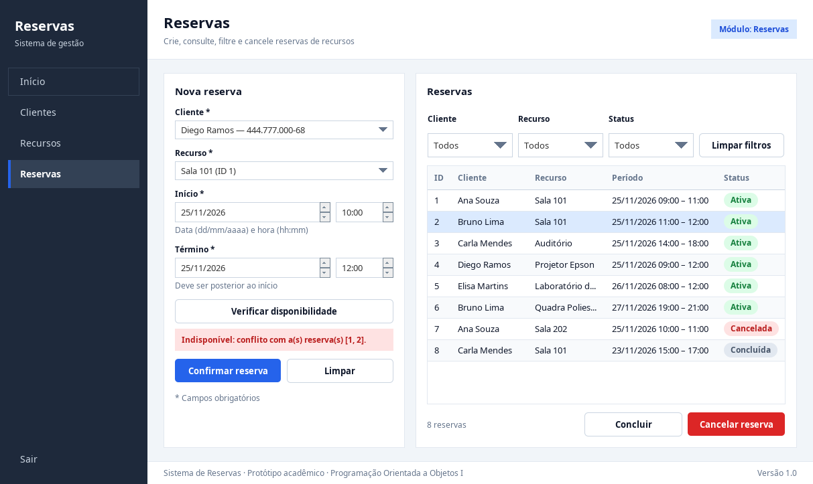
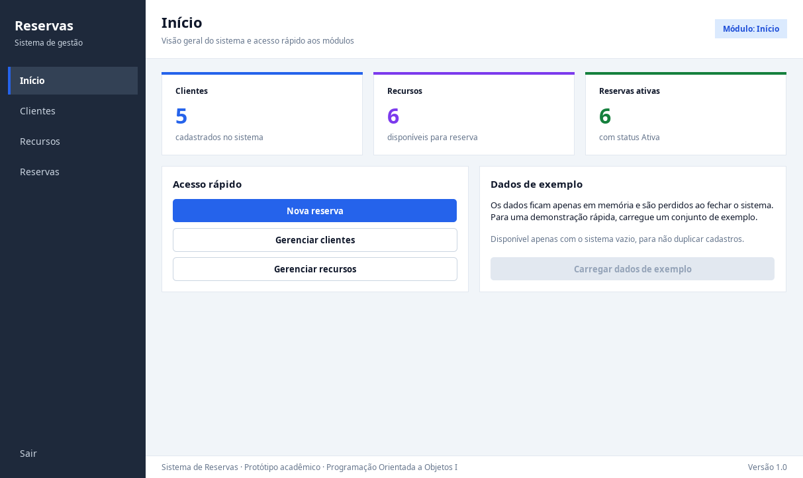
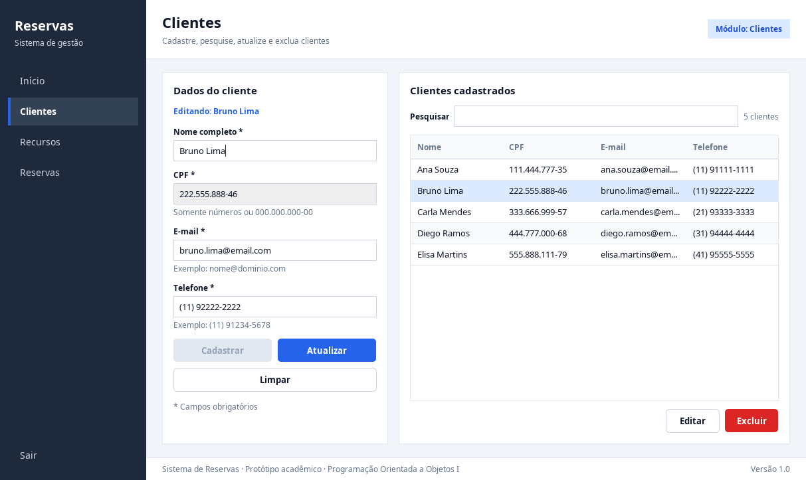
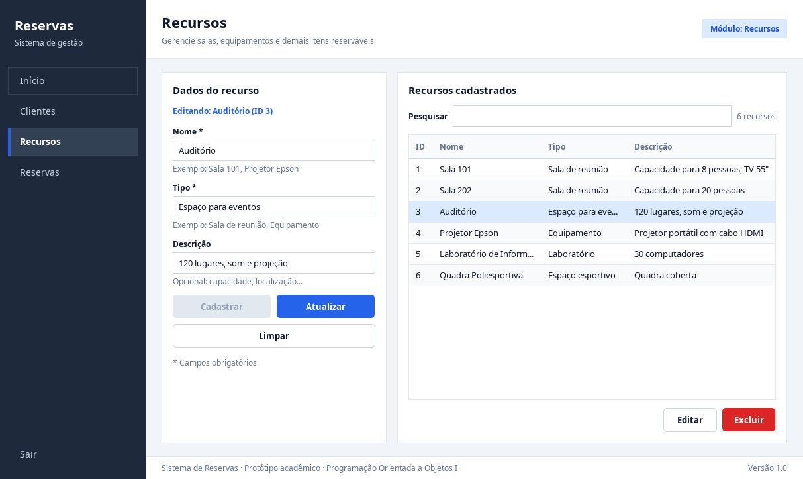
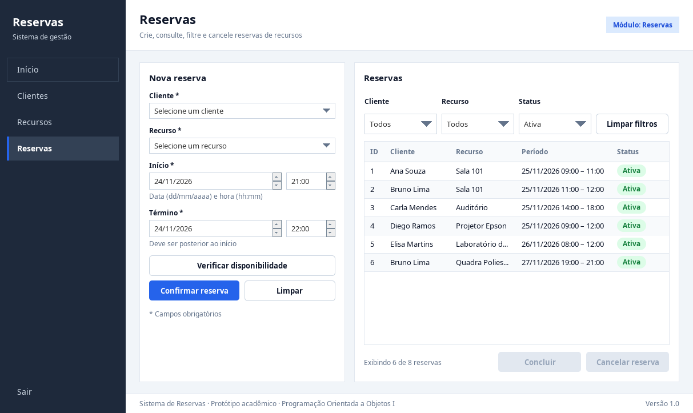
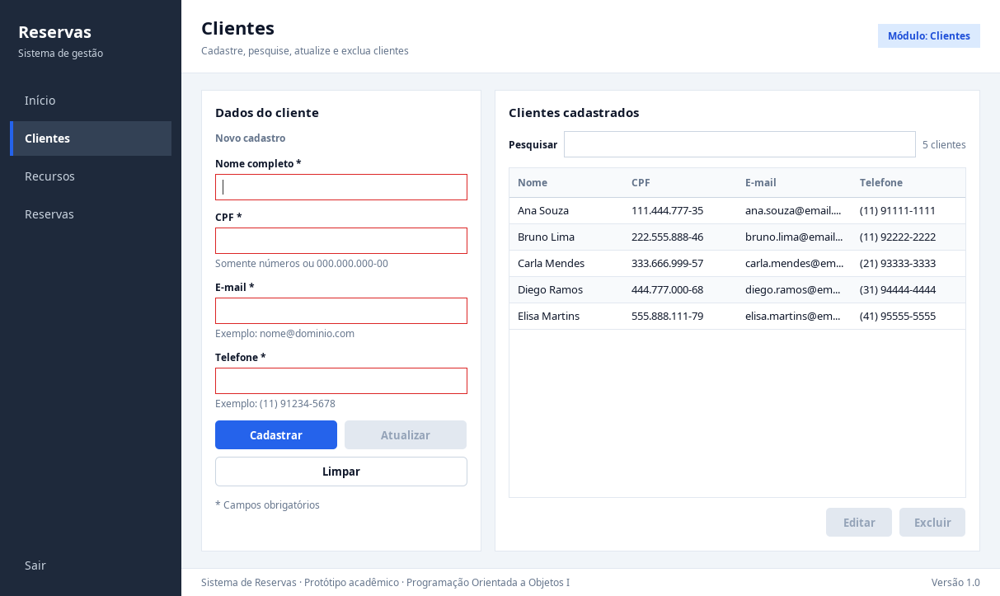
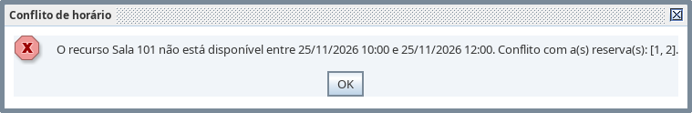

# Sistema de Reservas — Java Swing (POO I)

Sistema desktop para gerenciar **clientes**, **recursos** (salas, equipamentos,
auditórios, quadras...) e **reservas**, com verificação de disponibilidade e
bloqueio de conflitos de horário.

Projeto acadêmico de **Programação Orientada a Objetos I**, escrito em
**Java puro**: sem frameworks, sem banco de dados e sem dependências externas.



---

## Sumário

- [Funcionalidades](#funcionalidades)
- [Tecnologias](#tecnologias)
- [Pré-requisitos](#pré-requisitos)
- [Instalação](#instalação)
- [Configuração do ambiente](#configuração-do-ambiente)
- [Como executar](#como-executar)
- [Testes](#testes)
- [Como usar](#como-usar)
- [Telas](#telas)
- [Estrutura do projeto](#estrutura-do-projeto)
- [Solução de problemas](#solução-de-problemas)
- [Documentação técnica](#documentação-técnica)

---

## Funcionalidades

| Módulo | O que faz |
|---|---|
| **Início** | Indicadores em tempo real (clientes, recursos, reservas ativas), acesso rápido e carga de dados de exemplo |
| **Clientes** | Cadastrar, pesquisar, editar e excluir. CPF único (aceito com ou sem pontuação). Não permite excluir cliente com reserva ativa |
| **Recursos** | Cadastrar, pesquisar, editar e excluir. ID gerado automaticamente. Não permite excluir recurso com reserva ativa |
| **Reservas** | Criar reservas com data e hora, verificar disponibilidade, impedir conflitos de horário, filtrar por cliente/recurso/status, cancelar e concluir |

Regras principais:

- Um recurso não pode ter duas reservas **ativas** com horários sobrepostos
  (horários que apenas se encostam, como 10h–12h e 12h–14h, são permitidos).
- Reservas canceladas ou concluídas liberam o horário.
- O término da reserva deve ser posterior ao início.

> Os dados ficam **apenas em memória**: são perdidos ao fechar o programa.

## Tecnologias

| Item | Uso |
|---|---|
| Java 17 (LTS) | Linguagem (compatível com Java 21) |
| Java Swing | Interface gráfica (Look and Feel Metal com tema próprio) |
| Java Collections | Armazenamento em memória (`List`, `ArrayList`) |
| `java.time` | Datas e horários (`LocalDateTime`) |

Arquitetura em camadas: `model` → `repository` → `service` → `view`.
Toda regra de negócio fica nos serviços; a interface apenas os utiliza.

---

## Pré-requisitos

| Requisito | Versão | Observação |
|---|---|---|
| **JDK** (Java Development Kit) | 17 ou superior | É preciso o **JDK** (que contém o `javac`), não apenas o JRE |
| **Git** | qualquer versão recente | Para clonar o repositório |
| **Ambiente gráfico** | — | A aplicação abre uma janela; não roda em servidores sem tela |

Nenhuma outra dependência é necessária (sem Maven, Gradle, banco de dados ou bibliotecas externas).

### Instalando o JDK

**Ubuntu / Debian**
```bash
sudo apt update
sudo apt install openjdk-17-jdk
```

**Fedora**
```bash
sudo dnf install java-17-openjdk-devel
```

**macOS** (com [Homebrew](https://brew.sh))
```bash
brew install openjdk@17
```

**Windows** (PowerShell)
```powershell
winget install EclipseAdoptium.Temurin.17.JDK
```
Ou baixe o instalador em [adoptium.net](https://adoptium.net) e marque a
opção **"Set JAVA_HOME"** durante a instalação.

### Verificando a instalação

```bash
java -version
javac -version
```

Ambos devem mostrar a versão **17** (ou superior). Se `javac` não for
encontrado, veja [Configuração do ambiente](#configuração-do-ambiente).

---

## Instalação

```bash
# 1. Clonar o repositório
git clone https://github.com/arthurtrawi/sistema-reservas.git

# 2. Entrar na pasta do projeto
cd sistema-reservas
```

> Substitua `arthurtrawi` pelo usuário ou organização onde o repositório foi publicado.

Não há etapa de instalação de dependências: basta compilar e executar.

---

## Configuração do ambiente

**Este projeto não usa variáveis de ambiente próprias.** Não há arquivo
`.env`, chaves de API, credenciais ou banco de dados para configurar.

A única configuração que pode ser necessária é a do **próprio Java**, caso o
comando `javac` não seja encontrado ou haja várias versões instaladas:

| Variável | Para que serve | Valor de exemplo |
|---|---|---|
| `JAVA_HOME` | Pasta de instalação do JDK | `/usr/lib/jvm/java-17-openjdk-amd64` |
| `PATH` | Permite usar `java` e `javac` em qualquer pasta | deve incluir `$JAVA_HOME/bin` |

**Linux / macOS** — adicione ao final de `~/.bashrc` (ou `~/.zshrc` no macOS):
```bash
export JAVA_HOME=/usr/lib/jvm/java-17-openjdk-amd64   # ajuste para o caminho do seu JDK
export PATH="$JAVA_HOME/bin:$PATH"
```
Depois rode `source ~/.bashrc` (ou abra um novo terminal).

Para descobrir o caminho do JDK:
- Linux: `readlink -f "$(which javac)" | sed 's:/bin/javac::'`
- macOS: `/usr/libexec/java_home -v 17`

**Windows** (PowerShell, depois abra um novo terminal):
```powershell
setx JAVA_HOME "C:\Program Files\Eclipse Adoptium\jdk-17.0.x-hotspot"   # ajuste para a pasta do seu JDK
setx PATH "%PATH%;%JAVA_HOME%\bin"
```
Ou, pela interface: *Configurações → Sistema → Sobre → Configurações avançadas
do sistema → Variáveis de Ambiente*.

---

## Como executar

Todos os comandos são executados **na pasta raiz do projeto** (`sistema-reservas`).

### Linux / macOS

```bash
# Compilar (gera as classes na pasta out/)
javac -d out $(find src -name "*.java")

# Executar a aplicação
java -cp out Main
```

### Windows — PowerShell

```powershell
javac -d out (Get-ChildItem -Recurse src -Filter *.java).FullName
java -cp out Main
```

### Windows — Prompt de Comando (cmd)

```cmd
dir /s /b src\*.java > fontes.txt
javac -d out @fontes.txt
java -cp out Main
```

### Em uma IDE

- **IntelliJ IDEA**: *File → Open* → selecione a pasta. Clique com o botão
  direito em `src` → *Mark Directory as → Sources Root*. Execute `Main`.
- **Eclipse**: *File → New → Java Project*, desmarque "Use default location"
  e aponte para a pasta do projeto. Execute `Main`.
- **VS Code**: instale o *Extension Pack for Java*, abra a pasta e clique em
  *Run* acima do método `main` de `src/Main.java`.

---

## Testes

O projeto tem testes próprios, sem bibliotecas externas. Compile primeiro
(veja [Como executar](#como-executar)) e depois rode:

```bash
java -cp out teste.CenariosBackend      # 50 cenários das regras de negócio
java -cp out teste.CenariosInterface    # 72 cenários da interface gráfica
```

- `CenariosBackend` testa cadastros, conflitos, cancelamentos, consultas etc.
- `CenariosInterface` abre a janela e simula cliques e digitação
  (a janela pode aparecer rapidamente na tela; isso é esperado).

Cada cenário aparece como `[OK]` ou `[FALHOU]`, com um resumo ao final.
O resultado esperado é **`Reprovados: 0`**. O programa termina com código de
saída `1` se algum cenário falhar (útil em integração contínua).

---

## Como usar

1. Ao abrir, a tela **Início** está vazia. Clique em
   **Carregar dados de exemplo** para ter clientes, recursos e reservas prontos.
2. **Clientes / Recursos**: preencha o formulário e clique em **Cadastrar**.
   Clique em uma linha da tabela para editar (**Atualizar**) ou **Excluir**.
   O campo **Pesquisar** filtra a tabela.
3. **Reservas**: escolha cliente, recurso, início e término.
   **Verificar disponibilidade** mostra se o horário está livre;
   **Confirmar reserva** cria a reserva. Selecione uma reserva ativa para
   **Cancelar** ou **Concluir**. Use os filtros acima da tabela para consultar.
4. **Sair** pede confirmação (os dados em memória serão perdidos).

Campos com `*` são obrigatórios. Mensagens de erro (CPF duplicado, conflito
de horário, exclusão não permitida...) explicam o motivo da recusa.

---

## Telas

| Início | Clientes |
|---|---|
|  |  |

| Recursos | Reservas filtradas |
|---|---|
|  |  |

| Campos obrigatórios | Erro de conflito de horário |
|---|---|
|  |  |

Para regenerar as imagens após mudanças na interface:
`java -cp out teste.GeradorCapturas docs/imagens`

---

## Estrutura do projeto

```
sistema-reservas/
├── src/
│   ├── Main.java            Ponto de entrada: monta o sistema e abre a janela
│   ├── model/               Entidades: Cliente, Recurso, Reserva, StatusReserva
│   ├── repository/          Armazenamento em memória
│   ├── service/             Regras de negócio
│   ├── exception/           Exceções personalizadas
│   ├── util/                Validações e formatação de datas
│   ├── view/                Interface gráfica (Swing)
│   │   ├── componentes/     Componentes visuais reutilizáveis
│   │   ├── inicio/          Painel Início e dados de exemplo
│   │   ├── cliente/         Módulo de Clientes
│   │   ├── recurso/         Módulo de Recursos
│   │   └── reserva/         Módulo de Reservas
│   └── teste/               Testes automatizados e gerador de capturas
├── docs/imagens/            Capturas de tela
├── .gitignore
├── README.md
└── DOCUMENTACAO_IA.md       Documentação técnica detalhada
```

A pasta `out/` (classes compiladas) é gerada pela compilação e não faz parte
do repositório.

---

## Solução de problemas

| Problema | Causa provável | Solução |
|---|---|---|
| `javac: command not found` / `'javac' não é reconhecido` | JDK não instalado ou fora do `PATH` | Instale o JDK e configure `JAVA_HOME`/`PATH` ([ver acima](#configuração-do-ambiente)) |
| `UnsupportedClassVersionError` | `java` mais antigo que o `javac` usado na compilação | Use JDK 17+ para compilar **e** executar (`java -version`) |
| `Could not find or load main class Main` | Comando executado fora da raiz ou sem compilar | Entre na pasta `sistema-reservas` e compile antes de executar |
| `HeadlessException` / `No X11 DISPLAY` | Executado sem ambiente gráfico (servidor, SSH, contêiner) | Execute em um computador com interface gráfica. `CenariosBackend` funciona sem tela |
| Acentos estranhos no terminal do Windows | Codificação do console | Rode `chcp 65001` antes dos comandos |

---

## Documentação técnica

Arquitetura, modelagem das classes, regras de negócio, integração entre
interface e serviços, conceitos de POO aplicados e histórico de decisões:
[DOCUMENTACAO_IA.md](DOCUMENTACAO_IA.md).
